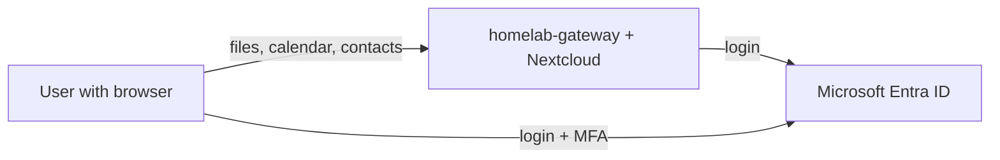
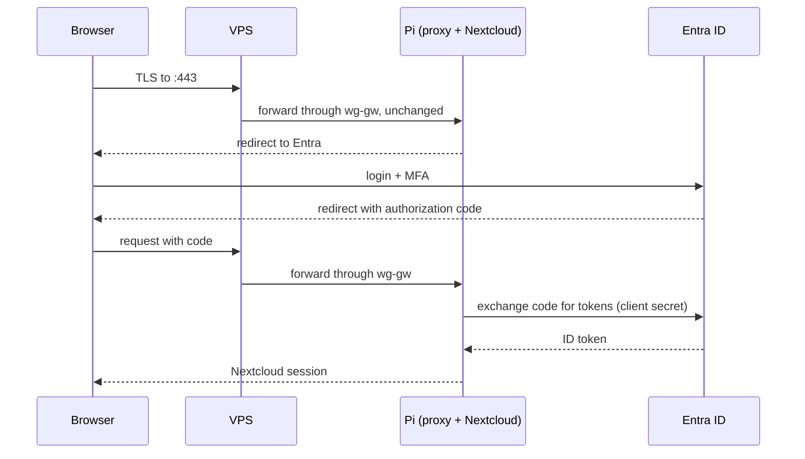

# homelab-gateway: Architecture

Structure based on the [arc42](https://arc42.org) template (version 9.1-EN) by Dr. Peter Hruschka, Dr. Gernot Starke and contributors.

Related documents:

- [`docs/NOTES.md`](../NOTES.md): shell commands, source for the setup scripts
- [`scripts/`](../../scripts/): `setup-vps.sh`, `setup-pi.sh`
- [`docs/Manual_Setup.md`](../Manual_Setup.md): steps that can't be scripted, verification
- [`docs/adr/`](../adr/): architecture decision records

# 1. Introduction and Goals

## Requirements Overview

- browser access to the Nextcloud on the home Raspberry Pi from any device, including devices that aren't mine
- no VPN or client certificate needed on the client
- login through an external identity provider, no self-built authentication
- only explicitly allowed users get in

## Quality Goals

| Priority | Goal            | Meaning                                                                      |
|----------|-----------------|------------------------------------------------------------------------------|
| 1        | Confidentiality | nobody except the Pi can read content, including the VPS provider            |
| 2        | Isolation       | the public entry point must not reach anything in the home LAN except Nextcloud |
| 3        | Access control  | only assigned users can log in, with MFA                                     |
| 4        | Reproducibility | the whole setup can be rebuilt from the repo                                 |

## Stakeholders

| Role               | Expectations                                                              |
|--------------------|---------------------------------------------------------------------------|
| Owner / admin      | reliable access, low maintenance, setup is reproducible and documented    |
| Invited users      | simple browser login (planned, not yet)                                    |
| Flatmates          | their devices in the shared LAN are not exposed by the setup              |
| VPS provider       | not trusted with content                                                   |

# 2. Architecture Constraints

- the Pi sits behind CGNAT, it can't be reached from the internet directly
- the home LAN is shared with flatmates
- no credit or debit card for cloud accounts (rules out Azure free account, AWS paid plan)
- budget: one small VPS (netcup VPS pico, 12 months minimum term), free tiers otherwise
- no public website with an imprint, the home address must not be published
- Entra ID Free: no group-based app assignment, no Conditional Access
- everything is tested in local VMs before the VPS is bought and before the real Pi is touched

# 3. Context and Scope

## Business Context

| Partner            | Interface                                                  |
|--------------------|------------------------------------------------------------|
| User               | web browser; Nextcloud desktop/mobile apps via Login Flow v2 and app passwords |
| Microsoft Entra ID | OpenID Connect identity provider                           |

## Technical Context

| Channel                      | Direction                    | Content                                      |
|------------------------------|------------------------------|----------------------------------------------|
| HTTPS 443 on the VPS         | browser to VPS               | TLS, passed through unchanged                 |
| WireGuard UDP 51820          | Pi connects to VPS           | tunnel `wg-gw`, `10.99.0.0/24`               |
| HTTPS to Entra               | browser to Entra             | login page, MFA                               |
| HTTPS to Entra               | Pi to Entra (via home router) | code-for-token exchange with client secret  |

# 4. Solution Strategy

| Goal                    | Approach                                                                                   |
|-------------------------|--------------------------------------------------------------------------------------------|
| Reachable despite CGNAT | small VPS as public entry point, Pi builds an outgoing WireGuard tunnel to it              |
| Confidentiality         | TLS passthrough on the VPS, TLS terminates on the Pi                                       |
| Isolation               | tunnel only allows the peer `/32`, no IP forwarding, nftables on both hosts: the Pi accepts only the proxy port from the VPS, the VPS accepts nothing new from the tunnel |
| Access control          | OIDC login via Entra ID handled by Nextcloud (`user_oidc`), assignment required, MFA       |
| Reproducibility         | manual exploration in VMs, commands logged in `NOTES.md`, then idempotent setup scripts per host |

# 5. Building Block View

## Whitebox Overall System

| Building block     | Host | Responsibility                                                   | Status       |
|--------------------|------|------------------------------------------------------------------|--------------|
| WireGuard server   | VPS  | endpoint of the tunnel, listens on UDP 51820                     | done (VM)    |
| Firewall           | VPS  | nftables, only SSH, 443 and WireGuard, nothing new from the tunnel, rate limits for new SSH and HTTPS connections per IP | done (VM)  |
| TCP/TLS proxy      | VPS  | nginx `stream` with `ssl_preread`, forwards 443 for known hostnames (`cloud`, `portal`, the bare domain) into the tunnel, adds the PROXY header, limits open connections per IP | done (VM) |
| WireGuard client   | Pi   | connects to the VPS, keepalive 25 s                              | done (VM)    |
| Firewall           | Pi   | nftables, from the tunnel only 443 from the VPS, SSH only from the LAN | done (VM) |
| Reverse proxy      | Pi   | nginx, reads the PROXY header, TLS termination, certificate, forwards to Nextcloud and the portal, redirects the bare domain to the portal ([ADR 0021](../adr/0021-redirect-the-bare-domain-to-the-portal.md)) | done (VM) |
| Certificate        | Pi   | `*.<domain>` and `<domain>` in one certificate from Let's Encrypt, DNS-01 through a deSEC subzone (`_acme-challenge` is a CNAME into it), lego from Debian, daily timer with a hook that copies it for nginx; `.test` names keep a self-signed one ([ADR 0020](../adr/0020-get-the-certificate-with-dns-01-through-desec.md)) | done (VM, real domain) |
| Nextcloud          | Pi   | application, data on the separate data disk                      | done (VM), exists on the real Pi |
| `user_oidc`        | Pi   | OIDC login against Entra ID, maps app roles to groups, rejects users without an `nc-` role | done (VM) |
| Portal frontend    | Pi   | Angular start page, tiles per app role, system overview for `portal-admin`, served by nginx as static files | done (VM) |
| Portal API         | Pi   | Spring Boot on `127.0.0.1:8081`, Spring Security resource server that validates the Entra ID token forwarded by oauth2-proxy, service status, system status file | done (VM) |
| Auth proxy         | Pi   | oauth2-proxy on `127.0.0.1:4180` in front of the portal (later own apps), login against the Entra app "portal", sessions in Redis, only users with a portal app role ([ADR 0019](../adr/0019-put-oauth2-proxy-in-front-of-the-portal.md)) | done (VM) |

# 6. Runtime View

## Login

Notable:

- the VPS only sees encrypted TLS, never the code, tokens or content
- the token exchange runs from the Pi directly to Entra, not through the VPS
- Entra rejects unassigned users before a code is issued (AADSTS50105), Global Admins excepted (see section 11)
- Nextcloud then rejects everyone without an `nc-` app role in the ID token, which covers the Global Admin ([ADR 0013](../adr/0013-restrict-the-nextcloud-login-to-users-with-an-app-role.md))
- `/login` redirects straight to Entra, the local admin uses `/login?direct=1`

## Desktop client and WebDAV

- the client starts Login Flow v2, the user logs in through the browser as above, Nextcloud issues an app password to the client
- the client then syncs over WebDAV with that app password, through the same path (VPS, tunnel, Pi), no VPN on the client
- the app password doesn't depend on Entra; it's revoked in Nextcloud (user settings or `occ user:auth-tokens:delete`)

# 7. Deployment View

## Infrastructure Level 1

| Node         | Production                            | Test                   | Tunnel IP  |
|--------------|---------------------------------------|------------------------|------------|
| VPS          | netcup VPS pico (not bought yet)      | VM `vps`, Debian 13    | 10.99.0.1  |
| Raspberry Pi | Pi, OS on SD card, data on 1 TB SSD   | VM `Pi-VM`, Debian 13, 20 GB system + 30 GB data disk | 10.99.0.2 |

Inbound rules (nftables, table `inet gateway`, files in `configs/<host>/etc/nftables.conf`, see [ADR 0009](../adr/0009-use-nftables-with-a-dedicated-table.md)):

| Host | From                     | Allowed                                  |
|------|--------------------------|------------------------------------------|
| VPS  | anywhere                 | 22/tcp, 443/tcp, 51820/udp, ICMP echo    |
| VPS  | `wg-gw`                  | nothing new, only replies                |
| Pi   | `wg-gw`, from `10.99.0.1` | 443/tcp                                 |
| Pi   | LAN `192.168.178.0/24`   | 22/tcp                                   |
| Pi   | anywhere                 | ICMP echo                                |

- forwarding is dropped on both hosts, in addition to `ip_forward = 0`
- outgoing traffic is not filtered
- new connections are rate limited per source IP: 22/tcp 5/min (burst 10), 443/tcp 20/s (burst 50), see [ADR 0014](../adr/0014-rate-limit-connections-on-the-vps-instead-of-fail2ban-on-the-pi.md)
- production: SSH on the VPS is reachable from the internet, key only (hardening configs from phase 6), the real Pi needs additional rules for its existing VPN

TLS passthrough on the VPS: nginx `stream`, config in `configs/vps/etc/nginx/stream.d/gateway.conf`. Known hostnames go to `10.99.0.2:443` with a PROXY protocol header, everything else is closed on the VPS ([ADR 0010](../adr/0010-pass-the-client-ip-with-the-proxy-protocol.md), [ADR 0011](../adr/0011-forward-only-known-hostnames-on-the-vps.md)). At most 30 open connections per client IP, the ClientHello has to arrive within 5 s. The VPS doesn't serve HTTP, the nginx default site is removed.

The Pi also runs an existing WireGuard VPN for my own devices, kept separate from `wg-gw`.

# 8. Cross-cutting Concepts

## Secrets

- private keys are generated on the machine that uses them and never leave it
- client secret lives in the password manager, expiry date noted; it goes into `occ` through an environment variable (`--clientsecret-env`), never as a command line argument, because the shell history records every command
- client secret of the portal app: asked for on the terminal by `setup-pi.sh`, written to `/etc/oauth2-proxy/client-secret` (`0640 root:oauth2-proxy`), next to the generated cookie secret
- deSEC token: asked for by `setup-pi.sh`, written to `/etc/lego/desec-token` (`0600 root`), copy in the password manager; its token policy only allows TXT on `_acme-challenge.acme.<domain>`
- `configs/<host>/` mirrors the paths on each machine; configs without secrets (nftables) are committed as they are, WireGuard only as templates (`*.conf.example`), the real files are git-ignored
- `/etc/.git` (etckeeper) contains private keys and is never pushed
- SSH key on the PC with a passphrase, passphrase and fingerprint in the password manager; TOTP backup codes of the local admin there as well

## Authentication and authorization

- Entra ID is the only identity provider for regular users; "assignment required" plus MFA on the Entra side
- authorization in two steps: Entra decides who gets a token, Nextcloud only accepts tokens with an `nc-` app role ([ADR 0013](../adr/0013-restrict-the-nextcloud-login-to-users-with-an-app-role.md))
- app roles become Nextcloud groups at every OIDC login; data access inside Nextcloud is granted through shares to users or groups
- the Nextcloud user ID is the Entra object ID ([ADR 0012](../adr/0012-map-the-nextcloud-user-id-to-the-entra-object-id.md))
- the local admin is the break-glass account, only via `/login?direct=1`, with TOTP enforced through the group `local-2fa` ([ADR 0015](../adr/0015-enforce-2fa-only-for-the-local-admin.md))
- clients get app passwords that live on independently of Entra, revoking access means revoking them in Nextcloud too (tested: removed Entra assignment, existing app password still 207, 401 after `occ user:disable`)

## Hardening

| Layer | Measure |
|-------|---------|
| VPS network | nftables rate limits for new connections per IP, nginx `limit_conn` and short preread timeout ([ADR 0014](../adr/0014-rate-limit-connections-on-the-vps-instead-of-fail2ban-on-the-pi.md)) |
| SSH (both hosts) | key only, no root login, only the admin user from `ADMIN_USER`, `MaxAuthTries 3` |
| Nextcloud login | brute force protection per real client IP (PROXY protocol), Entra MFA for users, TOTP for the local admin |
| Nextcloud sharing | public links need a password and expire after 7 days, no public upload |
| Packages | unattended-upgrades with nightly reboot ([ADR 0016](../adr/0016-install-updates-automatically-with-a-nightly-reboot.md)) |

- no fail2ban on the Pi: it only sees the tunnel IP, a ban would hit the VPS

## Reproducibility

- every step is tried in the VMs first, VMware snapshots before larger changes
- shell history with timestamps, etckeeper for `/etc`
- working commands go into `NOTES.md`, then into `scripts/setup-vps.sh` and `scripts/setup-pi.sh`, tested on fresh VMs
- the scripts are idempotent and only replace files that differ; settings come from a git-ignored `.env`, secrets are asked for on the terminal

## Updates and monitoring

- Debian packages: unattended-upgrades on both hosts, Debian default origins (security and point releases), reboot if needed at 04:00 (VPS) and 04:30 (Pi), [ADR 0016](../adr/0016-install-updates-automatically-with-a-nightly-reboot.md)
- Nextcloud: not installed through apt, updated by hand with the built-in updater after a snapshot / backup; `occ update:check` and the update notification in the admin UI show new versions
- planned: uptime monitoring outside the Pi, alerts on vulnerabilities and available Nextcloud updates, client secret expiry, rate limit counters

# 9. Architecture Decisions

Each decision is recorded as an ADR in [`docs/adr/`](../adr/), with context, rejected alternatives and consequences.

| ADR | Decision | Status |
|-----|----------|--------|
| [0002](../adr/0002-vps-as-entry-point-pi-connects-out-via-wireguard.md) | VPS as entry point, Pi connects out via WireGuard | accepted |
| [0003](../adr/0003-use-tls-passthrough-on-the-vps.md) | TLS passthrough instead of termination on the VPS | accepted |
| [0004](../adr/0004-login-via-oidc-in-nextcloud.md) | Login via OIDC in Nextcloud (`user_oidc`) | accepted |
| [0005](../adr/0005-use-amazon-cognito-as-identity-provider.md) | Amazon Cognito as identity provider | superseded by 0006 |
| [0006](../adr/0006-use-microsoft-entra-id-via-azure-for-students.md) | Microsoft Entra ID via Azure for Students | accepted |
| [0007](../adr/0007-restrict-tunnel-to-32-without-ip-forwarding.md) | Tunnel restricted to `/32`, no IP forwarding | accepted |
| [0008](../adr/0008-use-a-separate-tunnel-wg-gw.md) | Separate tunnel `wg-gw` / `10.99.0.0/24` | accepted |
| [0009](../adr/0009-use-nftables-with-a-dedicated-table.md) | nftables with a dedicated table `inet gateway` | accepted |
| [0010](../adr/0010-pass-the-client-ip-with-the-proxy-protocol.md) | Client IP to the Pi via PROXY protocol | accepted |
| [0011](../adr/0011-forward-only-known-hostnames-on-the-vps.md) | Only known hostnames (SNI) are forwarded | accepted |
| [0012](../adr/0012-map-the-nextcloud-user-id-to-the-entra-object-id.md) | Nextcloud user ID = Entra object ID (`oid`) | accepted |
| [0013](../adr/0013-restrict-the-nextcloud-login-to-users-with-an-app-role.md) | Nextcloud login only with an app role | accepted |
| [0014](../adr/0014-rate-limit-connections-on-the-vps-instead-of-fail2ban-on-the-pi.md) | Rate limits on the VPS instead of fail2ban on the Pi | accepted |
| [0015](../adr/0015-enforce-2fa-only-for-the-local-admin.md) | 2FA enforced only for the local admin | accepted |
| [0016](../adr/0016-install-updates-automatically-with-a-nightly-reboot.md) | Automatic updates with a nightly reboot | accepted |
| [0017](../adr/0017-build-the-portal-with-angular-and-spring-boot.md) | Portal with Angular and Spring Boot | accepted, auth part amended by 0018 |
| [0018](../adr/0018-validate-the-entra-id-token-in-the-portal-api.md) | Validate the Entra ID token in the portal API | accepted, Nextcloud part corrected by 0019 |
| [0019](../adr/0019-put-oauth2-proxy-in-front-of-the-portal.md) | oauth2-proxy in front of the portal, not Nextcloud | accepted |
| [0020](../adr/0020-get-the-certificate-with-dns-01-through-desec.md) | Certificate with DNS-01 through deSEC | accepted, names amended by 0021 |
| [0021](../adr/0021-redirect-the-bare-domain-to-the-portal.md) | Bare domain redirects to the portal | accepted |

# 10. Quality Requirements

## Quality Scenarios

| Goal            | Scenario                                                                 | Expected result                               |
|-----------------|--------------------------------------------------------------------------|-----------------------------------------------|
| Confidentiality | the VPS is compromised                                                   | attacker sees only encrypted TLS              |
| Isolation       | an attacker on the VPS scans the tunnel                                  | only the reverse proxy port on the Pi answers |
| Isolation       | something on the Pi opens a connection to the VPS through the tunnel     | dropped by the VPS firewall                   |
| Isolation       | a scanner connects to the VPS IP without or with an unknown hostname     | closed on the VPS, nothing reaches the Pi     |
| Access control  | an attacker tries passwords against the login                            | brute force protection on the Pi throttles by the real client IP (PROXY protocol) |
| Access control  | an unassigned Entra user tries to log in                                 | rejected by Entra (AADSTS50105)               |
| Access control  | the Global Admin tries to log in                                         | passes Entra, rejected by Nextcloud (no app role) |
| Access control  | an app password is revoked                                               | next WebDAV request gets 401                  |
| Access control  | a user is disabled in Nextcloud after the Entra assignment was removed   | existing app passwords get 401                |
| Access control  | the local admin password leaks                                           | login still needs the TOTP code               |
| Access control  | someone tries SSH passwords on the VPS                                   | no password login, new connections limited to 5/min after a burst of 10 |
| Availability    | a scanner opens many connections to 443                                  | from 50 new connections in a burst, SYNs are dropped; at most 30 open connections per IP |
| Availability    | the VPS reboots                                                          | tunnel is back within ~25 s without manual work |

# 11. Risks and Technical Debts

| Risk                                                                 | Mitigation                                                                  |
|----------------------------------------------------------------------|-----------------------------------------------------------------------------|
| pre-auth vulnerability in the reverse proxy or Nextcloud is reachable from the internet | updates, rate limits, brute force protection, monitoring |
| compromised VPS requests its own certificate for the domain           | CAA record limited to Let's Encrypt and `dns-01`, the VPS has no DNS access; certificate transparency monitoring (open) |
| Global Admins bypass "assignment required" in Entra                   | admin account only for management, 2-step verification; Nextcloud rejects users without an `nc-` app role ([ADR 0013](../adr/0013-restrict-the-nextcloud-login-to-users-with-an-app-role.md)) |
| access removed in Entra, but existing app passwords keep working (groups only update at an OIDC login), confirmed in a test | remove the Entra assignment and `occ user:disable` the user, or revoke the app passwords with `occ user:auth-tokens:delete` |
| local admin login stays reachable via `/login?direct=1`              | strong password, brute force protection, TOTP enforced ([ADR 0015](../adr/0015-enforce-2fa-only-for-the-local-admin.md)) |
| Azure for Students ends after studying; tenant without subscription isn't officially guaranteed | no Azure resources in the subscription; fallback Auth0, migration only affects the login layer |
| client secrets of the Nextcloud and the portal app expire, login breaks | expiry dates in the password manager, calendar reminder 4 weeks ahead; later monitoring |
| oauth2-proxy is a pinned binary, not updated by unattended-upgrades   | watch the GitHub releases, bump version and hash in `setup-pi.sh`; listens on loopback only |
| certificate renewal fails unnoticed, Let's Encrypt sends no expiry mails anymore | daily timer, renewal 30 days ahead, `journalctl -u homelab-cert`; later monitoring |
| deSEC, or the NS/CNAME records for it at netcup, break                | renewal fails as above; records in `Manual_Setup.md` phase 9 |
| Nextcloud isn't updated by unattended-upgrades                         | `occ update:check`, update notification in the admin UI, documented update path; later monitoring |
| a nightly automatic reboot leaves a host down                          | snapshots in testing; uptime monitoring outside the Pi (open) |
| several users behind one IP (CGNAT, office) share the rate limits     | limits far above browser and desktop client needs, counters show drops |
| only one Global Admin, lockout if the account is lost                 | recovery code stored safely                                                |
| public share links in Nextcloud work without login                    | password and expiry date (7 days) enforced, no public upload               |
| VM IPs come from DHCP, a changed IP breaks the tunnel endpoint in testing | fixed leases in the router (open)                                      |
| Docker on the Pi turns on forwarding and routes published ports through the forward chain, past the input rules | not relevant, Nextcloud runs natively without Docker (phase 5) |
| SSH on the real VPS is reachable from the internet                    | key only, no root, `AllowUsers`, rate limit (configs ready, apply before go-live) |
| whoever reaches port 443 on the Pi can fake the client IP in the PROXY header | firewall allows 443 only from `10.99.0.1`; reverse proxy trusts the header only from there |
| SNI filter is no access control, the domain becomes public via certificate transparency | only meant to cut scanner noise, login and updates on the Pi remain the real protection |
| portal API, reachable directly on the Pi, could be called by another process without the auth proxy | API validates the Entra ID token forwarded by oauth2-proxy (issuer, `aud`, signature) in Spring Security, loopback bind stays as a second layer ([ADR 0018](../adr/0018-validate-the-entra-id-token-in-the-portal-api.md)) |
| Entra ID tokens expire after about one hour, the portal API would start returning 401 | oauth2-proxy `cookie_refresh` is shorter than the token lifetime so a new token is fetched in the background ([ADR 0018](../adr/0018-validate-the-entra-id-token-in-the-portal-api.md)) |

# 12. Glossary

| Term             | Definition                                                                         |
|------------------|------------------------------------------------------------------------------------|
| CGNAT            | carrier-grade NAT, the provider shares one public IPv4 between customers           |
| TLS passthrough  | proxy forwards TLS without decrypting it, routing based on the SNI                 |
| OIDC             | OpenID Connect, login protocol on top of OAuth 2.0                                 |
| Assignment required | Entra setting: only users assigned to the app can sign in                       |
| ADR              | architecture decision record                                                       |
| SNI              | server name indication, hostname sent unencrypted in the TLS ClientHello           |
| PROXY protocol   | header in front of a forwarded TCP connection that carries the original client and server address |
| App role         | role defined in an Entra app registration, assigned per user, sent in the `roles` claim |
| Login Flow v2    | Nextcloud login for clients: the browser handles the login, the client receives an app password |
| App password     | Nextcloud token for clients and WebDAV, independent of the identity provider       |
