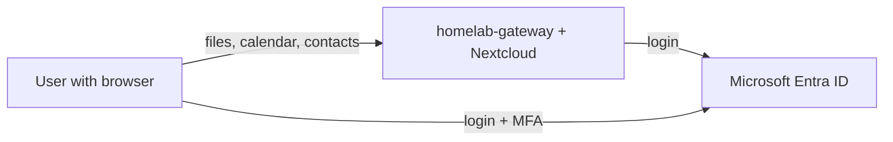
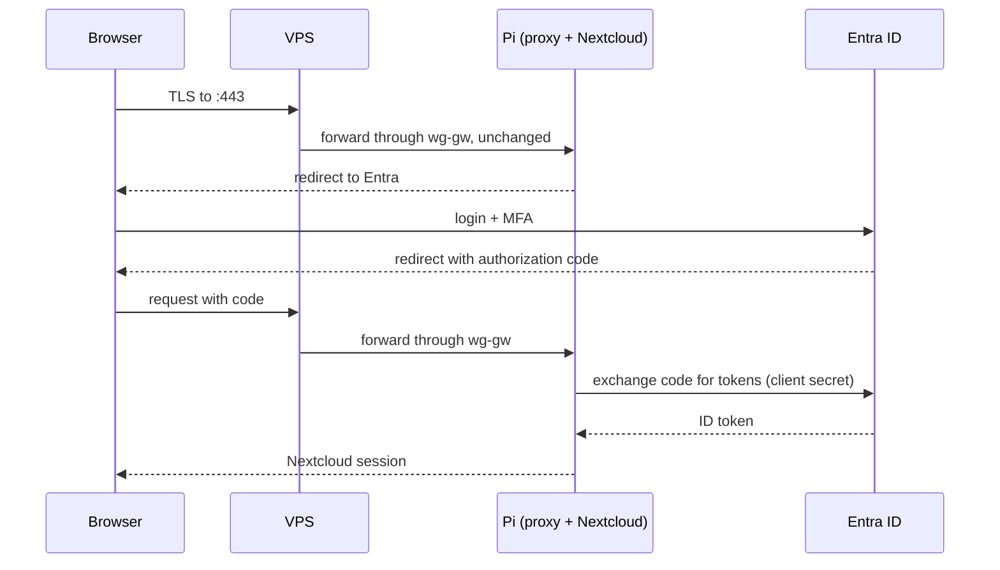

# homelab-gateway: Architecture

Structure based on the [arc42](https://arc42.org) template (version 9.1-EN) by Dr. Peter Hruschka, Dr. Gernot Starke and contributors.

Related documents:

- [`docs/NOTES.md`](../NOTES.md): shell commands, source for `setup.sh`
- [`docs/Manual_Setup.md`](../Manual_Setup.md): steps that can't be scripted, verification
- [`docs/adr/`](../adr/): architecture decision records

# 1. Introduction and Goals

## Requirements Overview

- browser access to the Nextcloud on the home Raspberry Pi from any device, including devices that aren't mine
- no VPN or client certificate needed on the client
- login through an external identity provider, no self-built authentication
- only explicitly allowed users get in

## Quality Goals

| Priority | Goal            | Meaning                                                                      |
|----------|-----------------|------------------------------------------------------------------------------|
| 1        | Confidentiality | nobody except the Pi can read content, including the VPS provider            |
| 2        | Isolation       | the public entry point must not reach anything in the home LAN except Nextcloud |
| 3        | Access control  | only assigned users can log in, with MFA                                     |
| 4        | Reproducibility | the whole setup can be rebuilt from the repo                                 |

## Stakeholders

| Role               | Expectations                                                              |
|--------------------|---------------------------------------------------------------------------|
| Owner / admin      | reliable access, low maintenance, setup is reproducible and documented    |
| Invited users      | simple browser login (planned, not yet)                                    |
| Flatmates          | their devices in the shared LAN are not exposed by the setup              |
| VPS provider       | not trusted with content                                                   |

# 2. Architecture Constraints

- the Pi sits behind CGNAT, it can't be reached from the internet directly
- the home LAN is shared with flatmates
- no credit or debit card for cloud accounts (rules out Azure free account, AWS paid plan)
- budget: one small VPS (netcup VPS pico, 12 months minimum term), free tiers otherwise
- no public website with an imprint, the home address must not be published
- Entra ID Free: no group-based app assignment, no Conditional Access
- everything is tested in local VMs before the VPS is bought and before the real Pi is touched

# 3. Context and Scope

## Business Context

| Partner            | Interface                                                  |
|--------------------|------------------------------------------------------------|
| User               | web browser, later possibly Nextcloud desktop/mobile apps  |
| Microsoft Entra ID | OpenID Connect identity provider                           |

## Technical Context

| Channel                      | Direction                    | Content                                      |
|------------------------------|------------------------------|----------------------------------------------|
| HTTPS 443 on the VPS         | browser to VPS               | TLS, passed through unchanged                 |
| WireGuard UDP 51820          | Pi connects to VPS           | tunnel `wg-gw`, `10.99.0.0/24`               |
| HTTPS to Entra               | browser to Entra             | login page, MFA                               |
| HTTPS to Entra               | Pi to Entra (via home router) | code-for-token exchange with client secret  |

# 4. Solution Strategy

| Goal                    | Approach                                                                                   |
|-------------------------|--------------------------------------------------------------------------------------------|
| Reachable despite CGNAT | small VPS as public entry point, Pi builds an outgoing WireGuard tunnel to it              |
| Confidentiality         | TLS passthrough on the VPS, TLS terminates on the Pi                                       |
| Isolation               | tunnel only allows the peer `/32`, no IP forwarding, nftables on both hosts: the Pi accepts only the proxy port from the VPS, the VPS accepts nothing new from the tunnel |
| Access control          | OIDC login via Entra ID handled by Nextcloud (`user_oidc`), assignment required, MFA       |
| Reproducibility         | manual exploration in VMs, commands logged in `NOTES.md`, later `setup.sh`                 |

# 5. Building Block View

## Whitebox Overall System

| Building block     | Host | Responsibility                                                   | Status       |
|--------------------|------|------------------------------------------------------------------|--------------|
| WireGuard server   | VPS  | endpoint of the tunnel, listens on UDP 51820                     | done (VM)    |
| Firewall           | VPS  | nftables, only SSH, 443 and WireGuard, nothing new from the tunnel | done (VM)  |
| TCP/TLS proxy      | VPS  | nginx `stream` with `ssl_preread`, forwards 443 for known hostnames into the tunnel, adds the PROXY header | done (VM) |
| WireGuard client   | Pi   | connects to the VPS, keepalive 25 s                              | done (VM)    |
| Firewall           | Pi   | nftables, from the tunnel only 443 from the VPS, SSH only from the LAN | done (VM) |
| Reverse proxy      | Pi   | reads the PROXY header, TLS termination, certificate, forwards to Nextcloud | planned |
| Nextcloud          | Pi   | application, data on the separate data disk                      | exists on the real Pi, VM planned |
| `user_oidc`        | Pi   | OIDC login against Entra ID                                      | planned      |

# 6. Runtime View

## Login (planned)

Notable:

- the VPS only sees encrypted TLS, never the code, tokens or content
- the token exchange runs from the Pi directly to Entra, not through the VPS
- Entra rejects unassigned users before a code is issued (AADSTS50105), Global Admins excepted (see section 11)

# 7. Deployment View

## Infrastructure Level 1

| Node         | Production                            | Test                   | Tunnel IP  |
|--------------|---------------------------------------|------------------------|------------|
| VPS          | netcup VPS pico (not bought yet)      | VM `vps`, Debian 13    | 10.99.0.1  |
| Raspberry Pi | Pi, OS on SD card, data on 1 TB SSD   | VM `Pi-VM`, Debian 13, 20 GB system + 30 GB data disk | 10.99.0.2 |

Inbound rules (nftables, table `inet gateway`, files in `configs/<host>/etc/nftables.conf`, see [ADR 0009](../adr/0009-use-nftables-with-a-dedicated-table.md)):

| Host | From                     | Allowed                                  |
|------|--------------------------|------------------------------------------|
| VPS  | anywhere                 | 22/tcp, 443/tcp, 51820/udp, ICMP echo    |
| VPS  | `wg-gw`                  | nothing new, only replies                |
| Pi   | `wg-gw`, from `10.99.0.1` | 443/tcp                                 |
| Pi   | LAN `192.168.178.0/24`   | 22/tcp                                   |
| Pi   | anywhere                 | ICMP echo                                |

- forwarding is dropped on both hosts, in addition to `ip_forward = 0`
- outgoing traffic is not filtered
- production: SSH on the VPS is reachable from the internet (hardening in phase 6), the real Pi needs additional rules for its existing VPN

TLS passthrough on the VPS: nginx `stream`, config in `configs/vps/etc/nginx/stream.d/gateway.conf`. Known hostnames go to `10.99.0.2:443` with a PROXY protocol header, everything else is closed on the VPS ([ADR 0010](../adr/0010-pass-the-client-ip-with-the-proxy-protocol.md), [ADR 0011](../adr/0011-forward-only-known-hostnames-on-the-vps.md)). The VPS doesn't serve HTTP, the nginx default site is removed.

The Pi also runs an existing WireGuard VPN for my own devices, kept separate from `wg-gw`.

# 8. Cross-cutting Concepts

## Secrets

- private keys are generated on the machine that uses them and never leave it
- client secret lives in the password manager, expiry date noted
- `configs/<host>/` mirrors the paths on each machine; configs without secrets (nftables) are committed as they are, WireGuard only as templates (`*.conf.example`), the real files are git-ignored
- `/etc/.git` (etckeeper) contains private keys and is never pushed

## Reproducibility

- every step is tried in the VMs first, VMware snapshots before larger changes
- shell history with timestamps, etckeeper for `/etc`
- working commands go into `NOTES.md`, later into `setup.sh`, tested against the `clean` snapshot

## Updates and monitoring

- planned, not decided yet: automatic security updates, uptime monitoring outside the Pi, alerts on vulnerabilities

# 9. Architecture Decisions

Each decision is recorded as an ADR in [`docs/adr/`](../adr/), with context, rejected alternatives and consequences.

| ADR | Decision | Status |
|-----|----------|--------|
| [0002](../adr/0002-vps-as-entry-point-pi-connects-out-via-wireguard.md) | VPS as entry point, Pi connects out via WireGuard | accepted |
| [0003](../adr/0003-use-tls-passthrough-on-the-vps.md) | TLS passthrough instead of termination on the VPS | accepted |
| [0004](../adr/0004-login-via-oidc-in-nextcloud.md) | Login via OIDC in Nextcloud (`user_oidc`) | accepted |
| [0005](../adr/0005-use-amazon-cognito-as-identity-provider.md) | Amazon Cognito as identity provider | superseded by 0006 |
| [0006](../adr/0006-use-microsoft-entra-id-via-azure-for-students.md) | Microsoft Entra ID via Azure for Students | accepted |
| [0007](../adr/0007-restrict-tunnel-to-32-without-ip-forwarding.md) | Tunnel restricted to `/32`, no IP forwarding | accepted |
| [0008](../adr/0008-use-a-separate-tunnel-wg-gw.md) | Separate tunnel `wg-gw` / `10.99.0.0/24` | accepted |
| [0009](../adr/0009-use-nftables-with-a-dedicated-table.md) | nftables with a dedicated table `inet gateway` | accepted |
| [0010](../adr/0010-pass-the-client-ip-with-the-proxy-protocol.md) | Client IP to the Pi via PROXY protocol | accepted |
| [0011](../adr/0011-forward-only-known-hostnames-on-the-vps.md) | Only known hostnames (SNI) are forwarded | accepted |

# 10. Quality Requirements

## Quality Scenarios

| Goal            | Scenario                                                                 | Expected result                               |
|-----------------|--------------------------------------------------------------------------|-----------------------------------------------|
| Confidentiality | the VPS is compromised                                                   | attacker sees only encrypted TLS              |
| Isolation       | an attacker on the VPS scans the tunnel                                  | only the reverse proxy port on the Pi answers |
| Isolation       | something on the Pi opens a connection to the VPS through the tunnel     | dropped by the VPS firewall                   |
| Isolation       | a scanner connects to the VPS IP without or with an unknown hostname     | closed on the VPS, nothing reaches the Pi     |
| Access control  | an attacker tries passwords against the login                            | brute force protection on the Pi throttles by the real client IP (PROXY protocol) |
| Access control  | an unassigned Entra user tries to log in                                 | rejected by Entra (AADSTS50105)               |
| Availability    | the VPS reboots                                                          | tunnel is back within ~25 s without manual work |

# 11. Risks and Technical Debts

| Risk                                                                 | Mitigation                                                                  |
|----------------------------------------------------------------------|-----------------------------------------------------------------------------|
| pre-auth vulnerability in the reverse proxy or Nextcloud is reachable from the internet | updates, rate limits, brute force protection, monitoring |
| compromised VPS requests its own certificate for the domain           | CAA record, certificate transparency monitoring                            |
| Global Admins bypass "assignment required" in Entra                   | admin account only for management, 2-step verification; additional check in Nextcloud (phase 5, open) |
| Azure for Students ends after studying; tenant without subscription isn't officially guaranteed | no Azure resources in the subscription; fallback Auth0, migration only affects the login layer |
| client secret expires, login breaks                                   | expiry date noted, reminder                                                |
| only one Global Admin, lockout if the account is lost                 | recovery code stored safely                                                |
| public share links in Nextcloud work without login                    | disable if not needed                                                       |
| VM IPs come from DHCP, a changed IP breaks the tunnel endpoint in testing | fixed leases in the router (open)                                      |
| Docker on the Pi turns on forwarding and routes published ports through the forward chain, past the input rules | not relevant, Nextcloud runs natively without Docker (phase 5) |
| SSH on the real VPS is reachable from the internet                    | key-only login and further hardening in phase 6                            |
| whoever reaches port 443 on the Pi can fake the client IP in the PROXY header | firewall allows 443 only from `10.99.0.1`; reverse proxy trusts the header only from there |
| SNI filter is no access control, the domain becomes public via certificate transparency | only meant to cut scanner noise, login and updates on the Pi remain the real protection |

# 12. Glossary

| Term             | Definition                                                                         |
|------------------|------------------------------------------------------------------------------------|
| CGNAT            | carrier-grade NAT, the provider shares one public IPv4 between customers           |
| TLS passthrough  | proxy forwards TLS without decrypting it, routing based on the SNI                 |
| OIDC             | OpenID Connect, login protocol on top of OAuth 2.0                                 |
| Assignment required | Entra setting: only users assigned to the app can sign in                       |
| ADR              | architecture decision record                                                       |
| SNI              | server name indication, hostname sent unencrypted in the TLS ClientHello           |
| PROXY protocol   | header in front of a forwarded TCP connection that carries the original client and server address |
